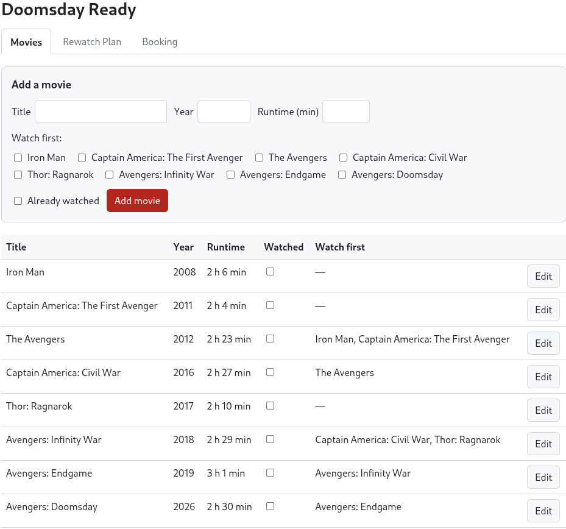
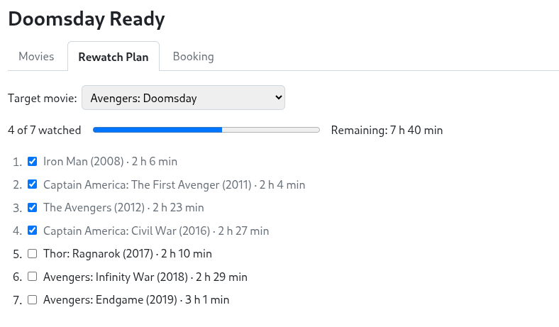
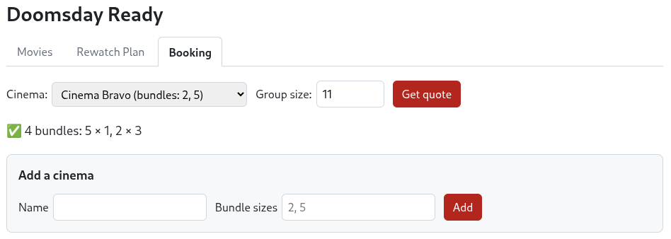
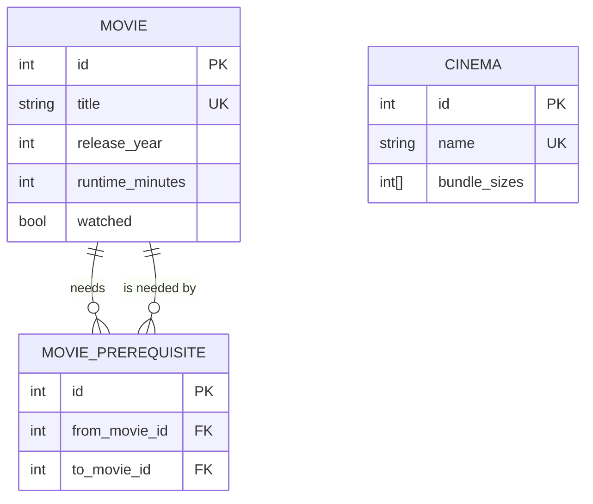

# Doomsday Ready

A small full-stack app for MCU fans getting ready for *Avengers: Doomsday*.
You can track movies and the movies you must watch first, get a valid rewatch order for any target
movie, and find the fewest seat bundles a cinema needs to seat a group exactly.
Built with Django REST Framework, PostgreSQL and React, all running in Docker Compose.





---

## 1. Quick start

### With Docker (one command)

You need Docker with Docker Compose. No `.env` file is needed.

```bash
docker compose up --build
```

Open **http://localhost:3000**. The sample movies and cinemas from the brief are loaded on the first start.

```bash
docker compose down      # stop
docker compose down -v   # stop and delete all data (the sample data comes back on the next start)
```

### Local development

You need Python 3.12+, Node 20+ and Docker (for the database only).
Every setting has a default, so no `.env` file is needed. `.env.example` lists the variables you can change.

```bash
# 1. Database
docker compose up -d db

# 2. Backend
cd backend
python3 -m venv .venv
source .venv/bin/activate
pip install -r requirements.txt
python manage.py migrate
python manage.py seed
python manage.py runserver          # http://localhost:8000

# 3. Frontend (in a second terminal, from the project root)
cd frontend
npm install
npm run dev                         # http://localhost:5173 (sends /api to :8000)
```

---

## 2. Design documents

- [`docs/DECISIONS.md`](docs/DECISIONS.md): why the app is designed this way.
- [`docs/ARCHITECTURE.md`](docs/ARCHITECTURE.md): the build spec (names, URLs, JSON fields, status and error codes).
- [`docs/TASKS.md`](docs/TASKS.md): the task list the app was built from, one task at a time.
- [`docs/PROMPTS.md`](docs/PROMPTS.md): the prompts used with Claude Code for each task.

---

## 3. API summary

All routes start with `/api` and have **no trailing slash**. Requests and responses are JSON.

| Method | Path | Body / query | Success |
|---|---|---|---|
| POST | `/api/movies` | movie fields | 201 + movie |
| GET | `/api/movies` | — | 200 + list, ordered by release year, then title |
| GET | `/api/movies/<id>` | — | 200 + movie |
| PATCH | `/api/movies/<id>` | any movie fields | 200 + movie |
| GET | `/api/movies/<id>/rewatch-order` | — | 200 + rewatch plan |
| POST | `/api/cinemas` | `name`, `bundle_sizes` | 201 + cinema |
| GET | `/api/cinemas` | — | 200 + list, ordered by name |
| GET | `/api/cinemas/<id>/booking` | `?groupSize=N` | 200 + booking quote |

The examples below use the seeded data on a fresh database (Docker on port 3000; use port 8000 for a
local backend).

**Create a movie**
```bash
curl -X POST http://localhost:3000/api/movies -H "Content-Type: application/json" \
  -d '{"title": "Spider-Man: Homecoming", "release_year": 2017, "runtime_minutes": 133, "prerequisites": [4]}'
```
```json
{"id": 9, "title": "Spider-Man: Homecoming", "release_year": 2017, "runtime_minutes": 133, "watched": false, "prerequisites": [4]}
```

**List movies**
```bash
curl http://localhost:3000/api/movies
```
```json
[{"id": 1, "title": "Iron Man", "release_year": 2008, "runtime_minutes": 126, "watched": false, "prerequisites": []}, "..."]
```

**Get one movie**
```bash
curl http://localhost:3000/api/movies/1
```
```json
{"id": 1, "title": "Iron Man", "release_year": 2008, "runtime_minutes": 126, "watched": false, "prerequisites": []}
```

**Update a movie** (only the fields you send change)
```bash
curl -X PATCH http://localhost:3000/api/movies/1 -H "Content-Type: application/json" -d '{"watched": true}'
```
```json
{"id": 1, "title": "Iron Man", "release_year": 2008, "runtime_minutes": 126, "watched": true, "prerequisites": []}
```

A change that would create a loop is blocked, for example making Endgame a prerequisite of Iron Man:
```bash
curl -X PATCH http://localhost:3000/api/movies/1 -H "Content-Type: application/json" -d '{"prerequisites": [7]}'
```
```json
{"error": {"code": "CIRCULAR_DEPENDENCY", "message": "This change would make a movie depend on itself.", "details": {}}}
```

**Rewatch order**
```bash
curl http://localhost:3000/api/movies/4/rewatch-order
```
```json
{
  "target": {"id": 4, "title": "Captain America: Civil War"},
  "movies": [
    {"id": 1, "title": "Iron Man", "release_year": 2008, "runtime_minutes": 126, "watched": true, "prerequisites": []},
    {"id": 2, "title": "Captain America: The First Avenger", "release_year": 2011, "runtime_minutes": 124, "watched": false, "prerequisites": []},
    {"id": 3, "title": "The Avengers", "release_year": 2012, "runtime_minutes": 143, "watched": false, "prerequisites": [1, 2]}
  ],
  "total_count": 3,
  "watched_count": 1,
  "unwatched_runtime_minutes": 267
}
```

**Create a cinema** (sizes are saved sorted)
```bash
curl -X POST http://localhost:3000/api/cinemas -H "Content-Type: application/json" \
  -d '{"name": "Cinema Echo", "bundle_sizes": [5, 2, 8]}'
```
```json
{"id": 5, "name": "Cinema Echo", "bundle_sizes": [2, 5, 8]}
```

**List cinemas**
```bash
curl http://localhost:3000/api/cinemas
```
```json
[{"id": 1, "name": "Cinema Alpha", "bundle_sizes": [1, 3, 4]}, {"id": 2, "name": "Cinema Bravo", "bundle_sizes": [2, 5]}, "..."]
```

**Booking quote**
```bash
curl "http://localhost:3000/api/cinemas/2/booking?groupSize=11"
```
```json
{"cinema": {"id": 2, "name": "Cinema Bravo"}, "group_size": 11, "possible": true, "total_bundles": 4,
 "bundles": [{"size": 5, "count": 1}, {"size": 2, "count": 3}]}
```

When no combination works, the answer is still `200`, with `possible: false`:
```bash
curl "http://localhost:3000/api/cinemas/4/booking?groupSize=7"
```
```json
{"cinema": {"id": 4, "name": "Cinema Delta"}, "group_size": 7, "possible": false, "total_bundles": null,
 "bundles": [], "message": "No combination of bundles adds up to exactly 7 seats."}
```

### Errors

Every error has the same shape:
```json
{"error": {"code": "VALIDATION_ERROR", "message": "Invalid input.", "details": {"groupSize": ["A valid integer is required."]}}}
```

| Status | `code` | When |
|---|---|---|
| 400 | `VALIDATION_ERROR` | bad or missing field, value out of range, unknown prerequisite id, bad `groupSize`, broken JSON |
| 404 | `NOT_FOUND` | the movie or cinema does not exist, or the URL is unknown |
| 405 | `METHOD_NOT_ALLOWED` | wrong HTTP method |
| 409 | `CIRCULAR_DEPENDENCY` | the change would make a movie depend on itself |
| 409 | `ALREADY_EXISTS` | duplicate movie title or cinema name (any letter case) |
| 500 | `INTERNAL_ERROR` | anything unexpected (no stack trace is shown) |

---

## 4. Data model



- A link `from_movie → to_movie` means: watch `to_movie` before `from_movie`.
- `bundle_sizes` is a PostgreSQL array, stored sorted with no duplicates.
- The database also enforces the rules: case-insensitive unique titles and names, runtime 1–300,
  release year 1900–2100.

---

## 5. How the algorithms work

The algorithms are plain Python with no Django inside: `backend/movies/graph.py` and
`backend/cinemas/bundles.py`. The services load the data from the database, call them and save the
result. Below, V = number of movies, E = number of prerequisite links.

### Cycle check: O(V + E)
When a movie gets new prerequisites, start at each new prerequisite and keep following *its*
prerequisites. If this walk ever reaches the movie being changed, the new link would close a loop
(A needs B, B needs … A), so the change is rejected with `409 CIRCULAR_DEPENDENCY`. A movie listed as its
own prerequisite is caught the same way. Each movie and link is visited at most once.

The check and the save run in one database transaction while holding a lock on the movies, so two
requests at the same time cannot each add half of a loop, and a rejected change leaves nothing behind.

### Rewatch order: O(V + E)
This is a depth-first search that puts a movie in the list only *after* all of its prerequisites are in
the list (post-order). A "visited" set makes sure a shared prerequisite appears only once, and the target
itself is left out. It uses its own stack instead of recursion, so a very long chain cannot hit Python's
recursion limit. Prerequisites are visited in release order, so when several orders are valid, older
movies come first.

### Booking: O(group size × number of bundle sizes)
This is the "coin change" problem with unlimited coins. For every seat count from 1 up to the group size,
work out the fewest bundles that add up to exactly that count: try each bundle size as the last bundle and
reuse the best answer already found for the remaining seats. Then walk back from the group size to read
off which bundles were used. If the group size cannot be reached, the answer is "not possible".

Always taking the biggest bundle (greedy) does not work: for sizes `[6, 9, 20]` and 44 people, greedy takes
20 + 20 and is stuck with 4 seats left, but the right answer is 20 + 9 + 9 + 6.

---

## 6. Assumptions

1. "Release year and runtime in minutes: 1–300" — the 1–300 range is for runtime only. Release year: 1900–2100.
2. Movie titles and cinema names are unique ignoring letter case; leading/trailing spaces are trimmed.
3. A booking that is not possible returns 200 with `possible: false` — a valid answer, not an error.
4. If several combinations use the same fewest bundles, one of them is returned (bigger bundles preferred).
5. If several rewatch orders are valid, earlier-released prerequisites come first.
6. Duplicate bundle sizes (e.g. `[2, 2]`) are rejected, because the brief says "different" sizes.
7. Duplicate prerequisite ids in one request are saved once; unknown ids → 400.
8. All errors share one JSON shape; codes beyond `CIRCULAR_DEPENDENCY` were added for consistency.
9. No delete or cinema-update endpoints — not asked for in the brief.
10. Avengers: Doomsday runtime in the seed data (150 min) is a placeholder.
11. The brief's sample data is preloaded (seeded) so every example can be checked right away.
12. Rare DRF errors not listed in the error table (e.g. 415 for a non-JSON body) keep DRF's status code and use the same error shape, with DRF's code in upper case (e.g. `UNSUPPORTED_MEDIA_TYPE`).
13. On the booking endpoint, an unknown cinema returns 404 before `groupSize` is checked, so a bad `groupSize` for a missing cinema is still 404.
14. Rewatch Plan: when every movie is watched, the progress bar and list stay visible and "All caught up — you're ready!" is shown above the list.
15. In `request()`, a 502/503/504 response without a JSON body (a proxy whose backend is down) is treated as a network failure: "Cannot reach the server.".
16. Booking view: the first cinema in the list (ordered by name) is selected when the view opens; the quote is fetched only when "Get quote" is clicked.
17. Booking view, add cinema: empty parts in the bundle sizes text are ignored, so "5, 2," and "5,,2" both become `[5, 2]`.
18. In Docker, `POSTGRES_HOST` and `POSTGRES_PORT` are fixed to `db` and `5432` in the compose file (not `${VAR:-default}`), so a local `.env` with `POSTGRES_HOST=localhost` cannot point the backend container at itself.
19. The backend healthcheck calls `GET /api/movies` with Python's `urllib` (no curl in the slim image). The frontend waits for it, so nginx starts only after migrate, seed and gunicorn are ready and the first `/api` request does not get a 502. 20 retries × 5s gives migrate + seed up to about 100 seconds.

---

## 7. How AI was used

- **Design.** I planned the design (requirements, data model, API, algorithms, frontend, Docker) step by
  step with Claude in a web chat. The results were written into `docs/DECISIONS.md`,
  `docs/ARCHITECTURE.md`, `docs/TASKS.md` and `docs/PROMPTS.md`, which I reviewed and approved.
- **Algorithms.** Claude wrote `backend/movies/graph.py` and `backend/cinemas/bundles.py`,
  with their tests, in that chat. I then wrote both algorithms again myself from scratch,
  ran them against the same tests, and my version matched. I can explain both line by line.
- **Application code.** Claude Code in VS Code wrote the Django, React and Docker code one task at a time,
  using the prompts in `docs/PROMPTS.md`. I ran, tested and reviewed every task before committing it.
- **README.** Claude Code drafted this README from the docs; I checked every command and edited it.

<!-- In my own words: -->

---

## 8. Testing

From the project root (after the local development setup above):

```bash
docker compose up -d db
cd backend
source .venv/bin/activate
python manage.py test
```

There are 94 tests, and they all pass. They cover:

- **Algorithms** (`test_graph.py`, `test_bundles.py`): the brief's examples, a shared prerequisite
  listed once, a long chain with no recursion error, self-dependency, a case where greedy fails, a check
  against brute force on small inputs, and a speed check on the largest input.
- **Movie API** (`movies/tests/test_api.py`): create, list, get, PATCH, validation (strict integers and
  booleans, ranges, unknown prerequisite ids), case-insensitive duplicate titles, 404 / 405, and every
  rewatch example from the brief (Doomsday, Civil War, Ragnarok). Also Endgame → Iron Man returns 409 and
  leaves the database unchanged, and the movies table is locked only when prerequisites change.
- **Cinema API** (`cinemas/tests/test_api.py`): create, list, bundle-size validation, duplicate names,
  all four booking examples from the brief, and bad or out-of-range `groupSize` values.
- **Models and seed** (`test_models.py`, `test_seed.py`): database constraints, ordering, and a seed
  command that only fills empty tables and never overwrites changes.

API tests check both the status code and the JSON body. The frontend has no automated tests; it is
checked by `npm run build` and by hand.

---

## 9. What I would improve with more time

- Add frontend tests (Vitest + React Testing Library) for the three views and `api.js`.
- Add delete and edit endpoints for movies and cinemas, with a rule for what happens to movies that
  depend on a deleted movie.
- Run the backend tests and the frontend build in CI (GitHub Actions) on every push.
- Add user accounts so each fan has their own watched list instead of one shared list.
- Add pagination and search to the movie list if the data set grows beyond the MCU.
