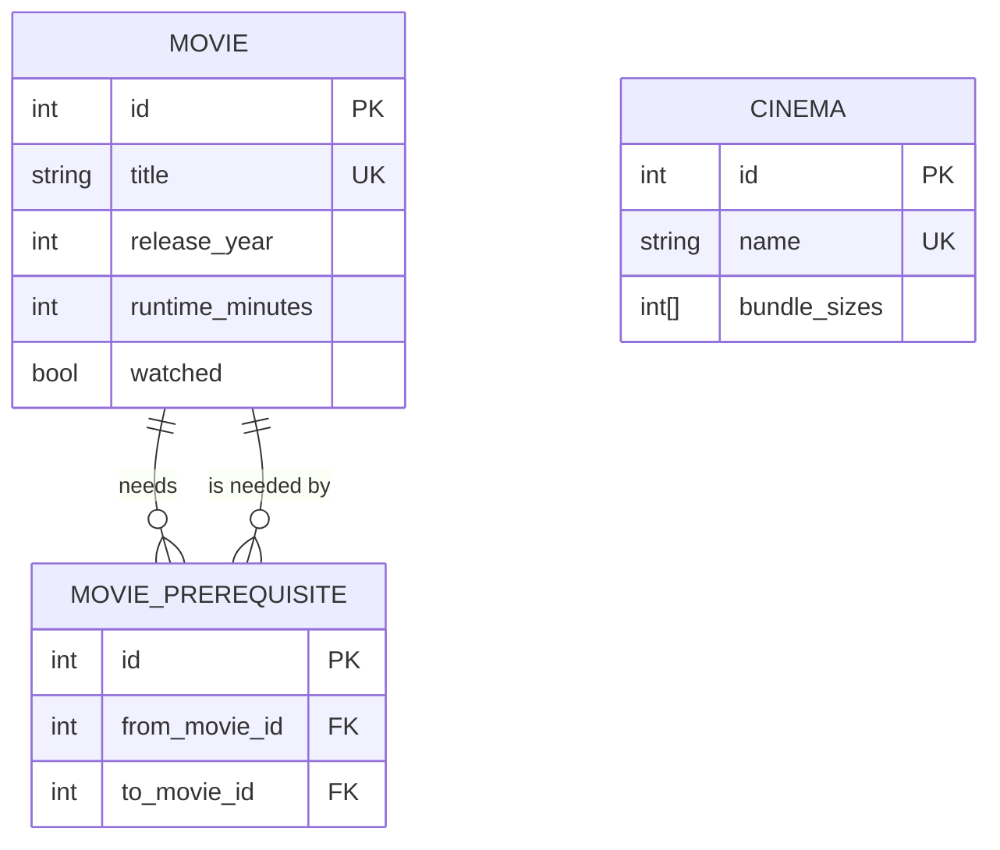

# Doomsday Ready — Architecture

This is the build spec. Follow it exactly. The reasons behind each decision are in
`docs/DECISIONS.md`. If this file and DECISIONS.md ever disagree, this file wins.

**Stack:** Python 3.12+ (local dev on 3.14 is fine), Django 5.2 LTS (latest 5.2.x patch, at least 5.2.8), Django REST Framework 3, PostgreSQL 16, React 18 + Vite, Docker Compose.

---

## 1. Folder structure

```
doomsday-ready/
├── README.md
├── CLAUDE.md
├── docker-compose.yml
├── .env.example
├── .gitignore
├── docs/                       DECISIONS.md, ARCHITECTURE.md, TASKS.md, PROMPTS.md
├── backend/
│   ├── Dockerfile
│   ├── .dockerignore
│   ├── entrypoint.sh
│   ├── requirements.txt
│   ├── manage.py
│   ├── config/
│   │   ├── settings.py
│   │   ├── urls.py
│   │   ├── exceptions.py
│   │   ├── views.py
│   │   ├── wsgi.py
│   │   └── asgi.py
│   ├── movies/
│   │   ├── models.py
│   │   ├── serializers.py
│   │   ├── services.py
│   │   ├── graph.py            ALREADY WRITTEN — do not change
│   │   ├── views.py
│   │   ├── urls.py
│   │   ├── apps.py
│   │   ├── admin.py
│   │   ├── migrations/
│   │   ├── management/commands/seed.py
│   │   └── tests/
│   │       ├── test_graph.py   ALREADY WRITTEN — do not change
│   │       ├── test_api.py
│   │       └── test_seed.py
│   └── cinemas/
│       ├── models.py
│       ├── serializers.py
│       ├── services.py
│       ├── bundles.py          ALREADY WRITTEN — do not change
│       ├── views.py
│       ├── urls.py
│       ├── apps.py
│       ├── admin.py
│       ├── migrations/
│       └── tests/
│           ├── test_bundles.py ALREADY WRITTEN — do not change
│           └── test_api.py
└── frontend/
    ├── Dockerfile
    ├── .dockerignore
    ├── nginx.conf
    ├── package.json
    ├── vite.config.js
    ├── index.html
    └── src/
        ├── main.jsx
        ├── App.jsx
        ├── api.js
        ├── format.js
        ├── styles.css
        ├── components/ErrorMessage.jsx
        └── views/
            ├── MoviesView.jsx
            ├── RewatchPlanView.jsx
            └── BookingView.jsx
```

### Backend layer rules
| Layer | Does | Never does |
|---|---|---|
| `views.py` | read request → call service → return `Response` | business logic, direct queries |
| `serializers.py` | validate input, shape output | cycle check, booking math, transactions |
| `services.py` | transactions, locks, queries, call `graph.py` / `bundles.py` | HTTP / `Response` objects |
| `graph.py`, `bundles.py` | pure algorithms on plain Python data | import Django, touch the database |

---

## 2. Core algorithms (already written and tested)

### `backend/movies/graph.py`
```python
creates_cycle(graph: dict[int, list[int]], movie_id: int, new_prerequisites: Iterable[int]) -> bool
rewatch_order(graph: dict[int, list[int]], target_id: int) -> list[int]
```
- `graph` maps each movie id to its prerequisite ids.
- `rewatch_order` returns prerequisite ids first, each once, the target excluded. It keeps the
  order of each prerequisite list, so the caller must sort those lists (see `load_graph`).
- Iterative (no recursion). O(V + E).

### `backend/cinemas/bundles.py`
```python
fewest_bundles(bundle_sizes: Iterable[int], group_size: int) -> list[tuple[int, int]] | None
```
- Returns `[(size, count), ...]`, largest size first, or `None` when no exact combination exists.
- Unbounded coin-change DP. O(group_size × number_of_sizes).

**Rules:** call these functions; never reimplement or modify them; never add a library that solves
these problems (networkx, graphlib, toposort, etc.).

---

## 3. Data model



### `movies.Movie`
```python
class Movie(models.Model):
    title = models.CharField(max_length=200)
    release_year = models.PositiveSmallIntegerField()
    runtime_minutes = models.PositiveSmallIntegerField()
    watched = models.BooleanField(default=False)
    prerequisites = models.ManyToManyField(
        "self", symmetrical=False, related_name="required_for", blank=True
    )

    class Meta:
        ordering = ["release_year", "title"]
        constraints = [
            UniqueConstraint(Lower("title"), name="unique_movie_title_ci"),
            CheckConstraint(condition=Q(runtime_minutes__gte=1, runtime_minutes__lte=300),
                            name="movie_runtime_range"),
            CheckConstraint(condition=Q(release_year__gte=1900, release_year__lte=2100),
                            name="movie_release_year_range"),
        ]
```
- Link `(from_movie → to_movie)` means: watch `to_movie` before `from_movie`.
- Use `condition=` (Django 5.1+; this project uses 5.2).

### `cinemas.Cinema`
```python
class Cinema(models.Model):
    name = models.CharField(max_length=200)
    bundle_sizes = ArrayField(models.PositiveSmallIntegerField())

    class Meta:
        ordering = ["name"]
        constraints = [
            UniqueConstraint(Lower("name"), name="unique_cinema_name_ci"),
        ]
```
- `bundle_sizes` is stored sorted ascending, no duplicates (enforced by the serializer).

---

## 4. Validation rules (serializers)

### Movie input
| Field | POST | PATCH | Rules | Error |
|---|---|---|---|---|
| `title` | required | optional | string, trimmed, 1–200 chars after trimming | 400 |
| `title` uniqueness | — | — | case-insensitive, excluding the movie itself on PATCH | **409 ALREADY_EXISTS** |
| `release_year` | required | optional | integer 1900–2100 | 400 |
| `runtime_minutes` | required | optional | integer 1–300 | 400 |
| `watched` | optional (default `false`) | optional | boolean | 400 |
| `prerequisites` | optional (default `[]`) | optional | list of integers; duplicates removed; every id must exist | 400 (missing ids listed in `details`) |

- Booleans must be real JSON booleans; integers must be real integers (reject `"126"` strings, `true` as int, `2.5`).
- PATCH: fields not sent stay unchanged. `prerequisites` sent → replaces the whole list; `[]` clears it.
- Unknown fields in the body are ignored. `id` cannot be set.

### Cinema input
| Field | Rules | Error |
|---|---|---|
| `name` | required, string, trimmed, 1–200 chars | 400 |
| `name` uniqueness | case-insensitive | **409 ALREADY_EXISTS** |
| `bundle_sizes` | list of 1–10 integers, each 1–500, no duplicates | 400 |

- After validation, `bundle_sizes` is saved sorted ascending.

### `groupSize` query parameter
- Required. Must be a whole-number string (`"11"`). Range 1–10,000.
- Missing, empty, `"abc"`, `"2.5"`, `"0"`, `"10001"` → 400 VALIDATION_ERROR.

---

## 5. Services

### `movies/services.py`
```python
def load_graph() -> dict[int, list[int]]
```
- Every movie id is a key (movies with no prerequisites map to `[]`).
- One query for all movie ids, one query on `Movie.prerequisites.through` for all links.
- Each prerequisite list sorted by the prerequisite's `(release_year, title)`.

```python
def create_movie(validated_data: dict) -> Movie
```
- Inside `transaction.atomic()`: pop `prerequisites`, create the row, then call
  `_apply_prerequisites(movie, ids)`.
- `IntegrityError` on the unique title → raise `AlreadyExists`.

```python
def update_movie(movie: Movie, validated_data: dict) -> Movie
```
- Inside `transaction.atomic()`.
- If `prerequisites` is in `validated_data` → `_apply_prerequisites(movie, ids)`.
- Set the other fields, `save()`.
- `IntegrityError` on the unique title → raise `AlreadyExists`.
- A watched-only PATCH must not lock the movies table.

```python
def _apply_prerequisites(movie: Movie, prerequisite_ids: list[int]) -> None
```
1. Lock: `list(Movie.objects.select_for_update().order_by("id").values_list("id", flat=True))`
   (evaluate it; this blocks a parallel prerequisite update until this transaction ends).
2. `graph = load_graph()`
3. `if creates_cycle(graph, movie.id, prerequisite_ids): raise CircularDependency()`
4. `movie.prerequisites.set(prerequisite_ids)`

Because everything runs in one transaction, a 409 leaves the database unchanged.

```python
def get_rewatch_plan(movie: Movie) -> dict
```
1. `ids = rewatch_order(load_graph(), movie.id)`
2. Load those movies in one query, with `prefetch_related("prerequisites")`; rebuild the list in `ids` order.
3. Return:
```python
{
    "target": {"id": movie.id, "title": movie.title},
    "movies": [movie objects in order],
    "total_count": len(ids),
    "watched_count": number of movies with watched=True,
    "unwatched_runtime_minutes": sum of runtime_minutes where watched=False,
}
```

### `cinemas/services.py`
```python
def create_cinema(validated_data: dict) -> Cinema
```
- `IntegrityError` on the unique name → raise `AlreadyExists`.

```python
def get_booking_quote(cinema: Cinema, group_size: int) -> dict
```
- `result = fewest_bundles(cinema.bundle_sizes, group_size)`
- Possible:
```python
{"cinema": {"id", "name"}, "group_size": N, "possible": True,
 "total_bundles": sum of counts,
 "bundles": [{"size": s, "count": c}, ...]}          # largest size first
```
- Not possible:
```python
{"cinema": {"id", "name"}, "group_size": N, "possible": False,
 "total_bundles": None, "bundles": [],
 "message": f"No combination of bundles adds up to exactly {N} seats."}
```

---

## 6. API

### General
- All routes under `/api`, **no trailing slash**. `APPEND_SLASH = False`.
- Explicit `path()` entries in each app's `urls.py` (no DRF router), so URLs match exactly.
- Use DRF `APIView` classes. JSON only (`JSONRenderer`; add `BrowsableAPIRenderer` only when `DEBUG`).
- JSON field names in `snake_case`. Only the query parameter is `groupSize`.
- Success codes: `201` for create, `200` for everything else.

### Movie object (every movie response)
```json
{ "id": 1, "title": "Iron Man", "release_year": 2008,
  "runtime_minutes": 126, "watched": false, "prerequisites": [] }
```
`prerequisites` = list of ids, sorted by the prerequisite's `(release_year, title)`.

### Endpoints
| Method | Path | Body / query | Success |
|---|---|---|---|
| POST | `/api/movies` | movie input | 201 + movie object |
| GET | `/api/movies` | — | 200 + list, ordered by `(release_year, title)` |
| GET | `/api/movies/<id>` | — | 200 + movie object |
| PATCH | `/api/movies/<id>` | any subset of movie fields | 200 + movie object |
| GET | `/api/movies/<id>/rewatch-order` | — | 200 + rewatch plan |
| POST | `/api/cinemas` | `{name, bundle_sizes}` | 201 + cinema object |
| GET | `/api/cinemas` | — | 200 + list, ordered by name |
| GET | `/api/cinemas/<id>/booking` | `?groupSize=N` | 200 + booking quote |

No pagination (the data set is small). No DELETE / PUT endpoints.

### Example: rewatch plan
`GET /api/movies/8/rewatch-order` (first four movies watched)
```json
{
  "target": { "id": 8, "title": "Avengers: Doomsday" },
  "movies": [
    { "id": 1, "title": "Iron Man", "release_year": 2008, "runtime_minutes": 126, "watched": true, "prerequisites": [] },
    "... 6 more movie objects in order ..."
  ],
  "total_count": 7,
  "watched_count": 4,
  "unwatched_runtime_minutes": 460
}
```

### Example: cinema object
```json
{ "id": 2, "name": "Cinema Bravo", "bundle_sizes": [2, 5] }
```

### Example: booking quote
`GET /api/cinemas/2/booking?groupSize=11`
```json
{ "cinema": { "id": 2, "name": "Cinema Bravo" }, "group_size": 11,
  "possible": true, "total_bundles": 4,
  "bundles": [ { "size": 5, "count": 1 }, { "size": 2, "count": 3 } ] }
```
`GET /api/cinemas/4/booking?groupSize=7`
```json
{ "cinema": { "id": 4, "name": "Cinema Delta" }, "group_size": 7,
  "possible": false, "total_bundles": null, "bundles": [],
  "message": "No combination of bundles adds up to exactly 7 seats." }
```

---

## 7. Errors

### Shape (every error, no exceptions)
```json
{ "error": { "code": "CIRCULAR_DEPENDENCY",
             "message": "This change would make a movie depend on itself.",
             "details": {} } }
```

### Codes
| Status | `code` | When | `message` |
|---|---|---|---|
| 400 | `VALIDATION_ERROR` | bad/missing field, out of range, unknown prerequisite id, bad `groupSize`, broken JSON | "Invalid input." (or the parse error) |
| 404 | `NOT_FOUND` | movie or cinema id does not exist; unknown URL | "Not found." |
| 405 | `METHOD_NOT_ALLOWED` | wrong HTTP method | "Method not allowed." |
| 409 | `CIRCULAR_DEPENDENCY` | the change would make a movie depend on itself | "This change would make a movie depend on itself." |
| 409 | `ALREADY_EXISTS` | duplicate title / name (any letter case) | "A movie with this title already exists." / "A cinema with this name already exists." |
| 500 | `INTERNAL_ERROR` | anything unexpected | "Something went wrong." (no stack trace) |

- `details` for 400: DRF field errors, e.g. `{"runtime_minutes": ["Ensure this value is less than or equal to 300."]}`.
- `details` is `{}` for every other code.

### Implementation
- `config/exceptions.py`:
  - `class CircularDependency(APIException)`: status 409, code `CIRCULAR_DEPENDENCY`.
  - `class AlreadyExists(APIException)`: status 409, code `ALREADY_EXISTS`.
  - `def api_exception_handler(exc, context)`: wraps DRF's default handler and converts every
    response to the shape above. Maps `ValidationError`/`ParseError` → `VALIDATION_ERROR`,
    `NotFound`/`Http404` → `NOT_FOUND`, `MethodNotAllowed` → `METHOD_NOT_ALLOWED`. Any exception
    DRF does not handle → 500 `INTERNAL_ERROR` (log it with `logging`, do not expose it).
- `settings.REST_FRAMEWORK["EXCEPTION_HANDLER"] = "config.exceptions.api_exception_handler"`.
- `config/views.py`: `handler404` and `handler500` return the same JSON shape for non-DRF URLs.

---

## 8. Frontend

### Rules
- React 18 + Vite, plain JavaScript. No UI library, no router, no state library.
- `App.jsx`: header "Doomsday Ready" + 3 tabs (Movies | Rewatch Plan | Booking) via `useState`.
- Each view fetches its own data when it mounts.
- All HTTP in `src/api.js`. Views never call `fetch`.
- One small `styles.css`. Readable on laptop and phone.

### `src/api.js`
| Function | Request |
|---|---|
| `listMovies()` | `GET /api/movies` |
| `createMovie(data)` | `POST /api/movies` |
| `updateMovie(id, data)` | `PATCH /api/movies/:id` |
| `getRewatchOrder(id)` | `GET /api/movies/:id/rewatch-order` |
| `listCinemas()` | `GET /api/cinemas` |
| `createCinema(data)` | `POST /api/cinemas` |
| `getBookingQuote(id, groupSize)` | `GET /api/cinemas/:id/booking?groupSize=N` |

Shared `request(path, options)`:
- Sends/accepts JSON.
- Non-OK → reads `body.error` and throws `Error(message)` with `.code` and `.details`.
- Network failure → throws `Error("Cannot reach the server.")`.

### `src/format.js`
| Call | Returns |
|---|---|
| `formatMinutes(460)` | `"7 h 40 min"` |
| `formatMinutes(126)` | `"2 h 6 min"` |
| `formatMinutes(120)` | `"2 h"` |
| `formatMinutes(45)` | `"45 min"` |
| `formatMinutes(0)` | `"0 min"` |
| `formatBundles([{size:5,count:1},{size:2,count:3}])` | `"5 × 1, 2 × 3"` |

### Shared UI behaviour (all views)
- Loading → "Loading…"; buttons disabled while a request is in flight.
- Error → `<ErrorMessage>` (red box) with `error.message`.
- Empty → a friendly line (texts below).
- Inputs use the API ranges (`required`, `min`, `max`); the API stays the final judge.

### View 1 — `MoviesView.jsx`
```
┌─ Add a movie ─────────────────────────────────────────────┐
│ Title [__________]  Year [____]  Runtime (min) [___]      │
│ Watch first: ☐ Iron Man  ☐ The First Avenger  ☐ ...       │
│ ☐ Already watched                          [ Add movie ]  │
└───────────────────────────────────────────────────────────┘
┌──────────────┬──────┬────────────┬─────────┬─────────────────────────┬────────┐
│ Title        │ Year │ Runtime    │ Watched │ Watch first             │        │
├──────────────┼──────┼────────────┼─────────┼─────────────────────────┼────────┤
│ Iron Man     │ 2008 │ 2 h 6 min  │   ☑     │ —                       │ [Edit] │
│ The Avengers │ 2012 │ 2 h 23 min │   ☐     │ Iron Man, First Avenger │ [Edit] │
└──────────────┴──────┴────────────┴─────────┴─────────────────────────┴────────┘
```
- Add form: title, year (1900–2100), runtime (1–300), prerequisite checkboxes, "Already watched".
  Success → clear form, reload list. Error → message above the form.
- Watched checkbox in the table → `PATCH {watched}` immediately, then reload.
- "Edit" → checkbox list of other movies (not itself) under that row, with Save / Cancel.
  Save → `PATCH {prerequisites}`. On 409 show the message under that row; nothing changes.
- Prerequisites shown as titles. Runtime shown with `formatMinutes`.
- Empty: "No movies yet. Add one above."

### View 2 — `RewatchPlanView.jsx`
```
Target movie: [ Avengers: Doomsday ▼ ]

4 of 7 watched   [██████████░░░░░░░]   Remaining: 7 h 40 min

 1. ☑ Iron Man (2008) · 2 h 6 min
 2. ☑ Captain America: The First Avenger (2011) · 2 h 4 min
 ...
 7. ☐ Avengers: Endgame (2019) · 3 h 1 min
```
- Dropdown of all movies → `getRewatchOrder(id)`.
- `<progress value={watched_count} max={total_count}>` + text "`watched_count` of `total_count` watched".
- "Remaining: `formatMinutes(unwatched_runtime_minutes)`".
- Numbered list in API order. Watched items faded / struck through.
- Ticking a checkbox → `PATCH {watched}` → reload the plan.
- Texts:
  - nothing picked: "Pick a movie to see what to watch first."
  - empty plan: "Nothing to watch first — you're ready!"
  - all watched: "All caught up — you're ready!"

### View 3 — `BookingView.jsx`
```
Cinema: [ Cinema Bravo (bundles: 2, 5) ▼ ]   Group size: [ 11 ]   [ Get quote ]

  ✅ 4 bundles: 5 × 1, 2 × 3

┌─ Add a cinema ───────────────────────────────────────────┐
│ Name [__________]  Bundle sizes [ 2, 5      ]  [ Add ]   │
└──────────────────────────────────────────────────────────┘
```
- Cinema dropdown shows name + bundle sizes. Group size input 1–10,000.
- Result:
  - possible → "✅ `total_bundles` bundles: `formatBundles(bundles)`"
  - not possible → "❌ Not possible — `message`"
- Changing cinema or group size clears the old result.
- Add cinema: name + sizes as text "2, 5" → split on commas, trim, convert to numbers → `createCinema`.
  Success → reload the dropdown and select the new cinema.
- Empty: "No cinemas yet. Add one below."

### Dev proxy
`vite.config.js`: `server.proxy["/api"] = "http://localhost:8000"`. No CORS needed.

---

## 9. Configuration

### `requirements.txt` (pin exact versions)
`Django` latest 5.2.x (at least 5.2.8, needed for Python 3.14), latest `djangorestframework` 3.x, latest `psycopg[binary]` 3.x, `gunicorn`. Pin the exact versions you install. Nothing else.

### Environment variables
| Variable | Default | Notes |
|---|---|---|
| `POSTGRES_DB` | `doomsday` | |
| `POSTGRES_USER` | `doomsday` | |
| `POSTGRES_PASSWORD` | `doomsday` | dev only |
| `POSTGRES_HOST` | `localhost` (local) / `db` (Docker) | |
| `POSTGRES_PORT` | `5432` | |
| `DJANGO_SECRET_KEY` | `dev-only-change-me` | |
| `DJANGO_DEBUG` | `True` local / `False` Docker | parse "true"/"false" |
| `DJANGO_ALLOWED_HOSTS` | `localhost,127.0.0.1,backend` | comma-separated; `backend` needed for nginx |

### Other settings
- `APPEND_SLASH = False`, `TIME_ZONE = "UTC"`, `USE_TZ = True`.
- `INSTALLED_APPS`: Django defaults + `django.contrib.postgres`, `rest_framework`, `movies`, `cinemas`.
- Logging to console.

---

## 10. Docker

### `docker-compose.yml`
| Service | Source | Ports | Details |
|---|---|---|---|
| `db` | `postgres:16-alpine` | `5432:5432` | volume `pgdata`; healthcheck `pg_isready -U doomsday` |
| `backend` | build `./backend` | `8000:8000` | `depends_on: db: condition: service_healthy`; env with defaults |
| `frontend` | build `./frontend` | `3000:80` | `depends_on: backend` |

All environment values have defaults inside the compose file (`${VAR:-default}`), so it runs with
no `.env` file.

```
Browser ─► localhost:3000 ─► nginx ─┬─ /       → React build
                                    └─ /api/   → backend:8000 (gunicorn + Django) ─► db:5432
```

### `backend/Dockerfile`
- `python:3.12-slim`, `PYTHONDONTWRITEBYTECODE=1`, `PYTHONUNBUFFERED=1`.
- Install requirements, copy code, create and switch to a non-root user.
- `ENTRYPOINT ["./entrypoint.sh"]`.

### `backend/entrypoint.sh`
```sh
#!/bin/sh
set -e
python manage.py migrate --noinput
python manage.py seed
exec gunicorn config.wsgi:application --bind 0.0.0.0:8000 --workers 3
```

### `frontend/Dockerfile` (multi-stage)
1. `node:20-alpine`: `npm ci` → `npm run build`.
2. `nginx:alpine`: copy `dist/` to `/usr/share/nginx/html`, copy `nginx.conf`.

### `frontend/nginx.conf`
- `location /api/ { proxy_pass http://backend:8000; }` (keeps the `/api` prefix; set
  `Host`, `X-Real-IP`, `X-Forwarded-For` headers).
- `location / { try_files $uri /index.html; }`

### `.dockerignore`
- backend: `__pycache__`, `.venv`, `*.pyc`, `.env`
- frontend: `node_modules`, `dist`, `.env`

---

## 11. Seed data — `python manage.py seed`

- Movies inserted **only if the movie table is empty**; cinemas **only if the cinema table is empty**.
  Otherwise print "Movies already seeded" / "Cinemas already seeded" and skip.
- Runs inside `transaction.atomic()`.
- Never overwrites user changes. To reset: `docker compose down -v`.

### Movies
| Title | Year | Runtime | Watch first |
|---|---|---|---|
| Iron Man | 2008 | 126 | — |
| Captain America: The First Avenger | 2011 | 124 | — |
| The Avengers | 2012 | 143 | Iron Man, Captain America: The First Avenger |
| Captain America: Civil War | 2016 | 147 | The Avengers |
| Thor: Ragnarok | 2017 | 130 | — |
| Avengers: Infinity War | 2018 | 149 | Captain America: Civil War, Thor: Ragnarok |
| Avengers: Endgame | 2019 | 181 | Avengers: Infinity War |
| Avengers: Doomsday | 2026 | 150 | Avengers: Endgame |

Doomsday runtime (150) is a placeholder.

### Cinemas
| Name | Bundle sizes |
|---|---|
| Cinema Alpha | 1, 3, 4 |
| Cinema Bravo | 2, 5 |
| Cinema Charlie | 6, 9, 20 |
| Cinema Delta | 4, 6 |

---

## 12. Testing

- Run with `python manage.py test` (needs the `db` container running locally).
- Algorithm tests (`test_graph.py`, `test_bundles.py`) are plain `unittest.TestCase` and already pass.
- API tests use DRF `APITestCase` and check status code **and** JSON body.
- Every example in the brief must have a test:
  - rewatch order for Doomsday, Civil War, Ragnarok
  - Endgame as a prerequisite of Iron Man → 409
  - booking for [1,3,4]/6, [2,5]/11, [6,9,20]/44, [4,6]/7
- Never delete or weaken a test to make it pass.

---

## 13. Assumptions (copy into README)

1. "Release year and runtime in minutes: 1–300" — the 1–300 range is for runtime only. Release year: 1900–2100.
2. Movie titles and cinema names are unique ignoring letter case; leading/trailing spaces are trimmed.
3. A booking that is not possible returns 200 with `possible: false` — a valid answer, not an error.
4. If several combinations use the same fewest bundles, one of them is returned (bigger bundles preferred).
5. If several rewatch orders are valid, earlier-released prerequisites come first.
6. Duplicate bundle sizes (e.g. `[2, 2]`) are rejected, because the brief says "different" sizes.
7. Duplicate prerequisite ids in one request are saved once; unknown ids → 400.
8. All errors share one JSON shape; codes beyond `CIRCULAR_DEPENDENCY` were added for consistency.
9. No delete or cinema-update endpoints — not asked for in the brief.
10. Avengers: Doomsday runtime in the seed data (150 min) is a placeholder.
11. The brief's sample data is preloaded (seeded) so every example can be checked right away.
