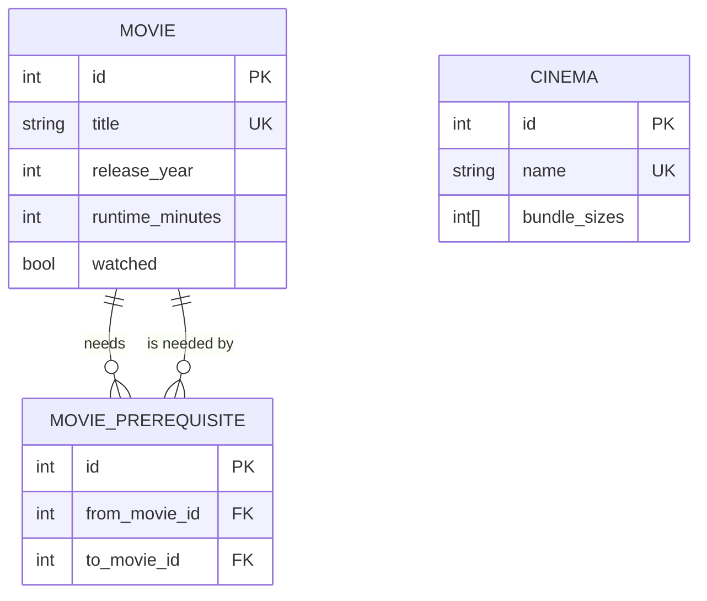

# Doomsday Ready — Design Decisions

Running log of decisions made during design. Steps 1–7 done.
Later steps (algorithms, frontend, structure, Docker) will be added here, then this file
feeds ARCHITECTURE.md.

**Stack:** Python, Django, Django REST Framework, PostgreSQL + React

---

## Step 1 — Requirements

### Feature 1: Movies and Rewatch Order
**Movie fields**
- Title: unique
- Release year
- Runtime in minutes: 1–300
- Prerequisites: movies to watch first (optional, can be changed later)
- Watched: true/false (default false, can be updated)

**Validation**
- A movie can never depend on itself, directly or through other movies.
- Any create or update that would cause this → `409 CIRCULAR_DEPENDENCY`.

**Rewatch order (given a target movie)**
- Return every movie needed before it (prerequisites, their prerequisites, and so on).
- Each movie exactly once.
- Every movie comes after its prerequisites.
- The target itself is not included.
- Also return how many are watched and the total runtime of the unwatched ones.

**Must pass (brief examples)**
| Request | Expected |
|---|---|
| Rewatch order for Avengers: Doomsday | All 7 other movies in a valid order |
| Rewatch order for Captain America: Civil War | Iron Man and The First Avenger (either order), then The Avengers |
| Rewatch order for Thor: Ragnarok | Empty list |
| Make Avengers: Endgame a prerequisite of Iron Man | 409 CIRCULAR_DEPENDENCY |

### Feature 2: Cinemas and Watch-Party Booking
**Cinema fields**
- Name: unique
- Bundle sizes: 1–10 different sizes, each 1–500 seats; any number of each can be bought.

**Booking quote**
- Group size: 1–10,000.
- Return the fewest bundles whose seats add up to exactly the group size, and how many of each size.
- If no exact combination exists, say so.

**Must pass (brief examples)**
| Bundle sizes | Group size | Expected |
|---|---|---|
| 1, 3, 4 | 6 | 2 bundles: 3 × 2 |
| 2, 5 | 11 | 4 bundles: 5 × 1, 2 × 3 |
| 6, 9, 20 | 44 | 4 bundles: 20 × 1, 9 × 2, 6 × 1 |
| 4, 6 | 7 | Not possible |

### Feature 3: React Frontend
1. **Movies** — add movies, edit prerequisites, tick as watched.
2. **Rewatch Plan** — pick a target; ordered list with watched ticks, progress bar ("4 of 7 watched"), remaining watch time.
3. **Booking** — pick a cinema, enter group size; show bundles to buy or "Not possible".

### Required endpoints (under `/api`, more may be added)
`POST /movies`, `GET /movies`, `PATCH /movies/:id`, `GET /movies/:id/rewatch-order`,
`POST /cinemas`, `GET /cinemas`, `GET /cinemas/:id/booking?groupSize=6`

### Rules and submission
- Work must be my own; AI use allowed but must be described in the README.
- Logic of Features 1 and 2 written without libraries that solve them.
- Unclear points: make a reasonable choice and note it in the README.
- Submit a Git repository link through the Google Form.
- Bonus: data model diagram in README; Docker Compose to start everything with one command.

### Assumptions (for README)
| # | Question | Decision |
|---|---|---|
| 1 | "Release year and runtime: 1–300" — does it cover year too? | No. 1–300 is for runtime only. Release year: 1900–2100. |
| 2 | Are "Iron Man" and "iron man" the same title? | Yes. Titles and cinema names are unique ignoring letter case; leading/trailing spaces are trimmed. |
| 3 | Status code when booking is not possible? | 200 with `possible: false` — it is a valid answer, not an error. |
| 4 | Several combinations with the same fewest bundles? | Return any one of them. |
| 5 | Several valid rewatch orders? | Earlier-released prerequisites come first. |
| 6 | Duplicate bundle sizes, e.g. [2, 2]? | Rejected (400) — the brief says "different" sizes. |
| 7 | Prerequisite id that does not exist? | 400 error. |
| 8 | Error format for other errors? | Decided in Step 3 (one shared error shape). |
| 9 | Delete or cinema edit endpoints? | Not built — not asked for in the brief. |
| 10 | Avengers: Doomsday runtime is unknown. | Placeholder value in seed data, noted in README as not real. |
| 11 | Should the brief's sample data be preloaded? | Yes — seeded so reviewers can check every example right away. |

---

## Step 2 — Data model



### Movie
| Field | Django type | Rules |
|---|---|---|
| id | AutoField | auto |
| title | CharField(200) | required, trimmed, unique ignoring case |
| release_year | PositiveSmallIntegerField | 1900–2100 |
| runtime_minutes | PositiveSmallIntegerField | 1–300 |
| watched | BooleanField | default False |
| prerequisites | ManyToManyField("self", symmetrical=False, related_name="required_for", blank=True) | list of movie ids |

- `symmetrical=False`: "The Avengers needs Iron Man" does not mean "Iron Man needs The Avengers". The link goes one way only.
- `related_name="required_for"`: lets us look from the other side (which movies need this one).

### MoviePrerequisite (link table)
- Created automatically by Django from the ManyToManyField.
- One row = one link: `(from_movie → to_movie)` means watch `to_movie` before `from_movie`.
- The same link cannot exist twice (Django guarantees this).
- Why a link table instead of an array: the database guarantees every prerequisite is a real movie, and the whole graph can be loaded in one query (needed for rewatch order and cycle check).

### Cinema
| Field | Django type | Rules |
|---|---|---|
| id | AutoField | auto |
| name | CharField(200) | required, trimmed, unique ignoring case |
| bundle_sizes | ArrayField(PositiveSmallIntegerField) | 1–10 items, each 1–500, no duplicates, stored sorted ascending |

- Why an array instead of a separate table: bundle sizes are a few small numbers, always read together, never searched on their own. PostgreSQL supports ArrayField.

### Where rules are checked (two layers)
1. **Serializer (API layer):** clear error messages for the user.
2. **Database constraints (last safety net):**
   - `UniqueConstraint(Lower("title"))` and `UniqueConstraint(Lower("name"))`
   - `CheckConstraint` for runtime and release-year ranges

   Bad data cannot get in even if two requests arrive at the same time.

- The cycle check is logic, not a table rule — covered in Step 4.

---

## Step 3 — API design

### General rules
- All URLs start with `/api`, no trailing slash (e.g. `/api/movies`), exactly as in the brief.
- JSON fields in `snake_case` (e.g. `release_year`); only the `groupSize` query param keeps the brief's spelling.
- Success: `201` when something is created, otherwise `200`.

### Movie object (used in every movie response)
```json
{ "id": 1, "title": "Iron Man", "release_year": 2008,
  "runtime_minutes": 126, "watched": false, "prerequisites": [] }
```
`prerequisites` is a list of movie ids.

### Movie endpoints
| Method / Path | Purpose | Success |
|---|---|---|
| `POST /api/movies` | Create a movie | 201 + movie |
| `GET /api/movies` | List movies, ordered by release year (then title) | 200 + list |
| `GET /api/movies/:id` | One movie *(extra, for the UI)* | 200 + movie |
| `PATCH /api/movies/:id` | Update any field | 200 + movie |
| `GET /api/movies/:id/rewatch-order` | Rewatch plan | 200 |

**POST body** — `title`, `release_year`, `runtime_minutes` required; `prerequisites`, `watched` optional:
```json
{ "title": "The Avengers", "release_year": 2012, "runtime_minutes": 143,
  "prerequisites": [1, 2] }
```

**PATCH body** — send only what changes:
```json
{ "watched": true }
{ "prerequisites": [3] }
```
- Sending `prerequisites` replaces the whole list.
- `[]` clears all prerequisites.
- Not sending it leaves the list unchanged.

**Rewatch order response**
```json
{
  "target": { "id": 8, "title": "Avengers: Doomsday" },
  "movies": [ {movie}, {movie}, "..." ],
  "total_count": 7,
  "watched_count": 4,
  "unwatched_runtime_minutes": 460
}
```

### Cinema endpoints
| Method / Path | Purpose | Success |
|---|---|---|
| `POST /api/cinemas` | Create a cinema | 201 + cinema |
| `GET /api/cinemas` | List cinemas, ordered by name | 200 + list |
| `GET /api/cinemas/:id/booking?groupSize=11` | Booking quote | 200 |

**POST body / Cinema object**
```json
{ "id": 2, "name": "Cinema Bravo", "bundle_sizes": [2, 5] }
```

**Booking quote — possible**
```json
{ "cinema": { "id": 2, "name": "Cinema Bravo" }, "group_size": 11,
  "possible": true, "total_bundles": 4,
  "bundles": [ { "size": 5, "count": 1 }, { "size": 2, "count": 3 } ] }
```

**Booking quote — not possible** (still `200`: it is a valid answer, not an error)
```json
{ "cinema": { "id": 4, "name": "Cinema Delta" }, "group_size": 7,
  "possible": false, "total_bundles": null, "bundles": [],
  "message": "No combination of bundles adds up to exactly 7 seats." }
```

### Error format (same shape for every error)
```json
{ "error": { "code": "CIRCULAR_DEPENDENCY",
             "message": "This change would make a movie depend on itself.",
             "details": {} } }
```

| Status | code | When |
|---|---|---|
| 400 | `VALIDATION_ERROR` | bad field, out of range, unknown prerequisite id, bad `groupSize`, broken JSON |
| 404 | `NOT_FOUND` | movie or cinema id does not exist |
| 405 | `METHOD_NOT_ALLOWED` | wrong HTTP method (e.g. `DELETE`) |
| 409 | `CIRCULAR_DEPENDENCY` | a movie would depend on itself, directly or indirectly |
| 409 | `ALREADY_EXISTS` | title or name already exists |
| 500 | `INTERNAL_ERROR` | unexpected problem (no internal details exposed) |

For `400`, `details` shows which field failed:
```json
"details": { "runtime_minutes": ["Ensure this value is less than or equal to 300."] }
```

---

## Step 4 — Feature 1 algorithm (cycle check + rewatch order)

File: `backend/movies/graph.py` — pure Python, no Django, no graph library.
Tests: `backend/movies/tests/test_graph.py` — 9 tests, all passing.

### The graph
A plain dict: `movie_id -> list of prerequisite ids`.
Loaded from the database in **one query** on the prerequisite link table. Each list is ordered
by the prerequisite's `(release_year, title)`, so the rewatch order comes out in a natural order.

Brief sample (ids 1–8):
```
1 Iron Man            -> []
2 The First Avenger   -> []
3 The Avengers        -> [1, 2]
4 Civil War           -> [3]
5 Ragnarok            -> []
6 Infinity War        -> [4, 5]
7 Endgame             -> [6]
8 Doomsday            -> [7]
```

### 4a. Cycle check — `creates_cycle(graph, movie_id, new_prerequisites)`
**Idea:** The graph in the database never has a cycle (we never let one in). So a new cycle can
only appear through the movie being changed. If we start from its new prerequisites and walk
"prerequisite of prerequisite of …", and we reach the movie itself, the change makes a cycle.

**Example — make Endgame a prerequisite of Iron Man:**
Start at Endgame → Infinity War → Civil War → The Avengers → **Iron Man** → reached → cycle → 409.

**Steps:**
1. If the movie is in its own new prerequisites → cycle (self-dependency).
2. Put the new prerequisites on a stack.
3. Pop one; if it is the movie → cycle. If already seen → skip. Else mark seen and push its prerequisites.
4. Stack empty without reaching the movie → no cycle.

**Complexity:** O(V + E) — each movie and link is visited at most once.

**Decisions**
- Iterative (own stack), not recursive → no recursion-limit crash on long chains.
- A brand-new movie cannot form a cycle (nothing points to it yet), but create still goes
  through the same function so every write uses one path.
- Runs only when `prerequisites` is in the request. A watched-only PATCH skips it.
- Concurrency: inside `transaction.atomic()`, lock movie rows with `select_for_update()` before
  loading the graph, so two parallel updates cannot together build a cycle.
- On 409, nothing is saved; the old prerequisites stay.

```python
def creates_cycle(graph, movie_id, new_prerequisites):
    if movie_id in new_prerequisites:
        return True

    stack = list(new_prerequisites)
    seen = set()
    while stack:
        current = stack.pop()
        if current == movie_id:
            return True
        if current in seen:
            continue
        seen.add(current)
        stack.extend(graph.get(current, ()))
    return False
```

### 4b. Rewatch order — `rewatch_order(graph, target_id)`
**Idea:** Post-order depth-first search (DFS). Go deep into a movie's prerequisites first; add a
movie to the list only after **all** its prerequisites are already in the list. That guarantees
"every movie comes after its prerequisites". A `visited` set guarantees "each movie exactly once".
The target is never added.

**Example — Civil War:**
Civil War → go to The Avengers → go to Iron Man (no prereqs) → add **Iron Man** →
go to The First Avenger (no prereqs) → add **The First Avenger** → The Avengers is done →
add **The Avengers** → back at Civil War (target, not added).
Result: Iron Man, The First Avenger, The Avengers. ✓

**Verified outputs on the brief sample**
| Target | Result |
|---|---|
| Doomsday | Iron Man, The First Avenger, The Avengers, Civil War, Ragnarok, Infinity War, Endgame |
| Civil War | Iron Man, The First Avenger, The Avengers |
| Ragnarok | (empty) |

The Doomsday result matches the example order in the brief exactly.

**Complexity:** O(V + E).

**Decisions**
- Iterative DFS with an explicit stack of `(movie, iterator over its prerequisites)` → no recursion limit.
- `visited` starts with the target, so even bad data cannot loop forever.
- Shared prerequisites (diamond shape) appear once.

```python
def rewatch_order(graph, target_id):
    order = []
    visited = {target_id}
    stack = [(target_id, iter(graph.get(target_id, ())))]
    done = object()

    while stack:
        node, children = stack[-1]
        child = next(children, done)
        if child is done:
            stack.pop()
            if node != target_id:
                order.append(node)
        elif child not in visited:
            visited.add(child)
            stack.append((child, iter(graph.get(child, ()))))

    return order
```

### 4c. Counts (done in the service, not in graph.py)
After getting the ordered ids, the service loads those movies in one query, keeps the order, and computes:
- `total_count` = length of the list
- `watched_count` = movies with `watched = true`
- `unwatched_runtime_minutes` = sum of runtime of movies with `watched = false`

Example: Iron Man, The First Avenger, The Avengers, Civil War watched →
`total_count` 7, `watched_count` 4, `unwatched_runtime_minutes` 130 + 149 + 181 = **460**.

### Tests (`test_graph.py`)
| Test | Checks |
|---|---|
| test_doomsday_needs_all_seven_others | 7 movies, each once, valid order |
| test_civil_war | Iron Man + First Avenger (any order), then The Avengers |
| test_ragnarok_is_empty | empty list |
| test_shared_prerequisite_appears_once | diamond graph, shared movie once |
| test_long_chain_does_not_hit_recursion_limit | 5,000-movie chain works |
| test_endgame_as_prerequisite_of_iron_man | cycle detected |
| test_self_dependency | movie as its own prerequisite detected |
| test_valid_new_link | valid change allowed |
| test_new_movie_cannot_cycle | new movie never cycles |

---

## Step 5 — Feature 2 algorithm (fewest bundles)

File: `backend/cinemas/bundles.py` — pure Python, no Django, no library.
Tests: `backend/cinemas/tests/test_bundles.py` — 6 tests, all passing.

### The problem
Bundle sizes (e.g. 2 and 5), unlimited of each. Find the **fewest** bundles whose seats add up to
**exactly** the group size. This is the classic **unbounded coin-change (minimum coins)** problem.

### Why not greedy ("always take the biggest bundle")?
Greedy gives wrong answers:
| Sizes | Group | Greedy | Correct |
|---|---|---|---|
| 1, 3, 4 | 6 | 4 + 1 + 1 = 3 bundles | 3 + 3 = **2 bundles** |
| 6, 9, 20 | 44 | 20 + 20 → 4 left → "not possible" | 20 + 9 + 9 + 6 = **4 bundles** |

### Dynamic programming idea
`best[t]` = fewest bundles to make exactly `t` seats.
- `best[0] = 0` (zero seats needs zero bundles).
- For every `t` from 1 to the group size, try every bundle size `s`:
  `best[t] = min(best[t], best[t − s] + 1)`
  ("use one bundle of size s, then the best way to make the rest").
- `last_pick[t]` remembers which size gave the best answer.
- If `best[group]` was never reached → **not possible**.
- To get the counts, walk back: from `group`, take `last_pick`, subtract it, repeat until 0.

### Example — sizes 2, 5 and group 11
| t | 0 | 1 | 2 | 3 | 4 | 5 | 6 | 7 | 8 | 9 | 10 | 11 |
|---|---|---|---|---|---|---|---|---|---|---|---|---|
| best[t] | 0 | ✗ | 1 | ✗ | 2 | 1 | 3 | 2 | 4 | 3 | 2 | **4** |
| last_pick | – | – | 2 | – | 2 | 5 | 2 | 5 | 2 | 5 | 5 | 5 |

Walk back: 11 −5 → 6 −2 → 4 −2 → 2 −2 → 0 → **5 × 1, 2 × 3 = 4 bundles** ✓

### Verified outputs (brief examples)
| Sizes | Group | Result |
|---|---|---|
| 1, 3, 4 | 6 | 3 × 2 (2 bundles) |
| 2, 5 | 11 | 5 × 1, 2 × 3 (4 bundles) |
| 6, 9, 20 | 44 | 20 × 1, 9 × 2, 6 × 1 (4 bundles) |
| 4, 6 | 7 | Not possible |

### Complexity
O(group_size × number_of_sizes). Worst case 10,000 × 10 = 100,000 steps → about 5 ms.
Memory: two lists of length group_size + 1.

### Decisions
- Sizes are tried largest first; on a tie the first one found is kept, so the answer leans toward
  bigger bundles. Any fewest combination is valid (Assumption 4).
- Duplicate sizes are removed inside the function as a safety net (the API already rejects them).
- Returns a list of `(size, count)`, largest size first, or `None` when not possible.
  The service turns it into the API response (`possible`, `total_bundles`, `bundles`, `message`).
- `groupSize` range (1–10,000) is checked in the API, before this function runs.

```python
def fewest_bundles(bundle_sizes, group_size):
    sizes = sorted(set(bundle_sizes), reverse=True)
    impossible = group_size + 1

    best = [0] + [impossible] * group_size
    last_pick = [0] * (group_size + 1)

    for total in range(1, group_size + 1):
        for size in sizes:
            if size <= total and best[total - size] + 1 < best[total]:
                best[total] = best[total - size] + 1
                last_pick[total] = size

    if best[group_size] >= impossible:
        return None

    counts = {}
    remaining = group_size
    while remaining > 0:
        size = last_pick[remaining]
        counts[size] = counts.get(size, 0) + 1
        remaining -= size

    return sorted(counts.items(), reverse=True)
```

### Tests (`test_bundles.py`)
| Test | Checks |
|---|---|
| test_examples_from_brief | all 4 brief examples |
| test_greedy_would_fail | [1, 5, 6, 9], 11 → 6 + 5 (greedy would give 3 bundles) |
| test_single_bundle | [7], 7 → 7 × 1 |
| test_group_smaller_than_every_bundle | [5, 10], 3 → not possible |
| test_matches_brute_force_on_small_inputs | 5 size sets × group 1–60, compared with trying every combination |
| test_largest_input_is_fast | 10 sizes, group 10,000, exact sum |

---

## Step 6 — Frontend design

### Tech choices
- React 18 + Vite, plain JavaScript (no TypeScript).
- No UI library, no router, no state library. Three tabs switched with `useState` in `App.jsx`.
- All HTTP calls in one file, `src/api.js`. Views never call `fetch` directly.
- One small CSS file. Clean, readable, works on a laptop screen and a phone.
- Each view loads its own data when it opens, so switching tabs always shows fresh data.

### Files
```
frontend/src/
├── main.jsx                 renders <App />
├── App.jsx                  header + 3 tabs: Movies | Rewatch Plan | Booking
├── api.js                   all API calls + error handling
├── format.js                formatMinutes(), formatBundles()
├── styles.css
├── components/
│   └── ErrorMessage.jsx     red box that shows error.message
└── views/
    ├── MoviesView.jsx
    ├── RewatchPlanView.jsx
    └── BookingView.jsx
```

### api.js
| Function | Calls |
|---|---|
| `listMovies()` | `GET /api/movies` |
| `createMovie(data)` | `POST /api/movies` |
| `updateMovie(id, data)` | `PATCH /api/movies/:id` |
| `getRewatchOrder(id)` | `GET /api/movies/:id/rewatch-order` |
| `listCinemas()` | `GET /api/cinemas` |
| `createCinema(data)` | `POST /api/cinemas` |
| `getBookingQuote(id, groupSize)` | `GET /api/cinemas/:id/booking?groupSize=N` |

One shared `request()` helper: sends JSON, and if the response is not OK it reads
`{"error": {code, message, details}}` and throws an `Error` with `message`, `code` and `details`.
If the server is down, it throws "Cannot reach the server."

### Shared UI rules (every view)
- **Loading:** "Loading…" text while data is fetched; buttons disabled while saving.
- **Error:** `ErrorMessage` shows `error.message` from the API (e.g. the circular-dependency message).
- **Empty:** a friendly line instead of an empty table.
- **Validation:** inputs use the same ranges as the API (`min`/`max`/`required`), but the API is the final judge.

---

### View 1 — Movies
```
┌─ Add a movie ─────────────────────────────────────────────┐
│ Title [__________]  Year [____]  Runtime (min) [___]      │
│ Watch first: ☐ Iron Man  ☐ The First Avenger  ☐ ...       │
│ ☐ Already watched                          [ Add movie ]  │
└───────────────────────────────────────────────────────────┘
┌──────────────┬──────┬────────────┬─────────┬─────────────────────────┬────────┐
│ Title        │ Year │ Runtime    │ Watched │ Watch first             │        │
├──────────────┼──────┼────────────┼─────────┼─────────────────────────┼────────┤
│ Iron Man     │ 2008 │ 2 h 6 min  │   ☑     │ —                       │ [Edit] │
│ The Avengers │ 2012 │ 2 h 23 min │   ☐     │ Iron Man, First Avenger │ [Edit] │
└──────────────┴──────┴────────────┴─────────┴─────────────────────────┴────────┘
```
- **Add form:** title, year (1900–2100), runtime (1–300), prerequisite checkboxes, watched checkbox.
  On success: clear the form and reload the list. On error: show the message above the form.
- **Watched checkbox in the table:** clicking it sends `PATCH {watched}` right away.
- **Edit prerequisites:** "Edit" opens a checkbox list under that row (the movie itself is not in the
  list). Save sends `PATCH {prerequisites: [...]}`; Cancel closes it.
  If the API returns 409, the message is shown right there under the row and nothing changes.
- Prerequisites are shown as titles, not ids.
- Checkboxes instead of `<select multiple>`: easier to use, no Ctrl-click needed.
- Empty state: "No movies yet. Add one above."

### View 2 — Rewatch Plan
```
Target movie: [ Avengers: Doomsday ▼ ]

4 of 7 watched   [██████████░░░░░░░]   Remaining: 7 h 40 min

 1. ☑ Iron Man (2008) · 2 h 6 min
 2. ☑ Captain America: The First Avenger (2011) · 2 h 4 min
 3. ☑ The Avengers (2012) · 2 h 23 min
 4. ☑ Captain America: Civil War (2016) · 2 h 27 min
 5. ☐ Thor: Ragnarok (2017) · 2 h 10 min
 6. ☐ Avengers: Infinity War (2018) · 2 h 29 min
 7. ☐ Avengers: Endgame (2019) · 3 h 1 min
```
- Dropdown of all movies. Picking one calls `getRewatchOrder(id)`.
- Progress: native `<progress value={watched} max={total}>` (accessible), plus text "4 of 7 watched".
- Remaining time from `unwatched_runtime_minutes`, shown with `formatMinutes()`.
- The list keeps the API order and is numbered.
- Ticking a movie sends `PATCH {watched}` and then reloads the plan, so counts are always right.
- Watched movies are shown faded / struck through.
- Empty plan (e.g. Thor: Ragnarok): "Nothing to watch first — you're ready!"
- All watched: "All caught up — you're ready for Doomsday!"
- No movie picked yet: "Pick a movie to see what to watch first."

### View 3 — Booking
```
Cinema: [ Cinema Bravo (bundles: 2, 5) ▼ ]   Group size: [ 11 ]   [ Get quote ]

  ✅ 4 bundles: 5 × 1, 2 × 3

┌─ Add a cinema ───────────────────────────────────────────┐
│ Name [__________]  Bundle sizes [ 2, 5      ]  [ Add ]   │
└──────────────────────────────────────────────────────────┘
```
- Dropdown shows each cinema with its bundle sizes.
- Group size: number input, 1–10,000.
- Result:
  - possible → "✅ 4 bundles: 5 × 1, 2 × 3" (built with `formatBundles()`)
  - not possible → "❌ Not possible — no combination of bundles adds up to exactly 7 seats."
- Changing the cinema or group size clears the old result.
- **Add cinema:** name + bundle sizes typed as "2, 5". The text is split on commas into numbers
  before sending. On success the new cinema appears in the dropdown.

### format.js
| Function | Example |
|---|---|
| `formatMinutes(460)` | "7 h 40 min" |
| `formatMinutes(45)` | "45 min" |
| `formatMinutes(120)` | "2 h" |
| `formatMinutes(0)` | "0 min" |
| `formatBundles([{size: 5, count: 1}, {size: 2, count: 3}])` | "5 × 1, 2 × 3" |

### Dev setup
- `vite.config.js` proxies `/api` to `http://localhost:8000`, so the frontend calls `/api/...` with
  no CORS setup. In Docker, nginx does the same proxy (Step 7).

---

## Step 7 — Folder structure and Docker

### Full folder structure
```
doomsday-ready/
├── README.md
├── CLAUDE.md
├── docker-compose.yml
├── .env.example
├── .gitignore
├── docs/
│   ├── DECISIONS.md
│   ├── ARCHITECTURE.md
│   ├── TASKS.md
│   └── PROMPTS.md
├── backend/
│   ├── Dockerfile
│   ├── .dockerignore
│   ├── entrypoint.sh           migrate → seed → gunicorn
│   ├── requirements.txt
│   ├── manage.py
│   ├── config/
│   │   ├── settings.py         all settings from environment variables
│   │   ├── urls.py             /api/ → movies.urls, cinemas.urls
│   │   ├── exceptions.py       custom DRF exception handler + error classes
│   │   ├── views.py            JSON handler404 / handler500
│   │   ├── wsgi.py
│   │   └── asgi.py
│   ├── movies/
│   │   ├── models.py           Movie
│   │   ├── serializers.py      validation + movie object shape
│   │   ├── services.py         load_graph, create_movie, update_movie, get_rewatch_plan
│   │   ├── graph.py            Feature 1 algorithm (Step 4) — do not change
│   │   ├── views.py            thin: parse request → call service → return response
│   │   ├── urls.py
│   │   ├── apps.py
│   │   ├── admin.py
│   │   ├── migrations/
│   │   ├── management/commands/seed.py
│   │   └── tests/
│   │       ├── test_graph.py   (Step 4)
│   │       ├── test_api.py
│   │       └── test_seed.py
│   └── cinemas/
│       ├── models.py           Cinema
│       ├── serializers.py
│       ├── services.py         create_cinema, get_booking_quote
│       ├── bundles.py          Feature 2 algorithm (Step 5) — do not change
│       ├── views.py
│       ├── urls.py
│       ├── apps.py
│       ├── admin.py
│       ├── migrations/
│       └── tests/
│           ├── test_bundles.py (Step 5)
│           └── test_api.py
└── frontend/
    ├── Dockerfile
    ├── .dockerignore
    ├── nginx.conf
    ├── package.json
    ├── vite.config.js          dev proxy /api → http://localhost:8000
    ├── index.html
    └── src/                    (Step 6)
```

### Layer rules (backend)
| Layer | Does | Does not |
|---|---|---|
| `views.py` | read request, call service, return response | business logic, queries |
| `serializers.py` | validate input, shape output | cycle check, booking math |
| `services.py` | transactions, locks, queries, call algorithms | HTTP details |
| `graph.py` / `bundles.py` | pure algorithms on plain Python data | Django, database |

### Python packages (`requirements.txt`, pinned)
`Django 5.x`, `djangorestframework 3.x`, `psycopg[binary] 3.x`, `gunicorn`.
No CORS package (proxy instead). No graph or DP library.

### Environment variables (`.env.example`)
| Variable | Default | Used for |
|---|---|---|
| `POSTGRES_DB` | `doomsday` | database name |
| `POSTGRES_USER` | `doomsday` | database user |
| `POSTGRES_PASSWORD` | `doomsday` | database password (dev only) |
| `POSTGRES_HOST` | `db` (Docker) / `localhost` (local) | database host |
| `POSTGRES_PORT` | `5432` | database port |
| `DJANGO_SECRET_KEY` | `dev-only-change-me` | Django secret |
| `DJANGO_DEBUG` | `False` in Docker, `True` local | debug mode |
| `DJANGO_ALLOWED_HOSTS` | `localhost,127.0.0.1,backend` | `backend` is needed because nginx calls the API by that name |

Defaults are written in `docker-compose.yml`, so `docker compose up --build` works **without** creating `.env`.

### docker-compose.yml — 3 services
| Service | Image / build | Port | Details |
|---|---|---|---|
| `db` | `postgres:16-alpine` | 5432 | named volume `pgdata`; healthcheck `pg_isready` |
| `backend` | `./backend` | 8000 | starts only after `db` is healthy; runs `entrypoint.sh` |
| `frontend` | `./frontend` | **3000 → 80** | nginx serves the React build, proxies `/api` to `backend:8000` |

```
Browser ──► http://localhost:3000 ──► nginx (frontend)
                                       ├── /        → React build (index.html, JS, CSS)
                                       └── /api/... → backend:8000 (gunicorn + Django) ──► db:5432
```

### backend/Dockerfile
- Base: `python:3.12-slim`.
- Install `requirements.txt`, copy code, run as a non-root user.
- `entrypoint.sh`:
  1. `python manage.py migrate --noinput`
  2. `python manage.py seed`
  3. `exec gunicorn config.wsgi:application --bind 0.0.0.0:8000 --workers 3`

### frontend/Dockerfile (multi-stage)
1. **Build stage** — `node:20-alpine`: `npm ci`, `npm run build` → `dist/`.
2. **Serve stage** — `nginx:alpine`: copy `dist/` and `nginx.conf`.

### nginx.conf
- `location /api/` → `proxy_pass http://backend:8000;` (keeps the `/api` path).
- `location /` → serve files, fall back to `index.html`.

### Seed command (`python manage.py seed`)
- Runs on every backend start, so a fresh clone always has the brief's data.
- Safe to run many times: movies are seeded **only if the movie table is empty**, cinemas
  **only if the cinema table is empty**. Otherwise it prints "already seeded" and does nothing.
- So a restart never overwrites the user's own changes (watched ticks, edited prerequisites,
  added movies or cinemas).

**Movies**
| Title | Year | Runtime | Watch first |
|---|---|---|---|
| Iron Man | 2008 | 126 | — |
| Captain America: The First Avenger | 2011 | 124 | — |
| The Avengers | 2012 | 143 | Iron Man, The First Avenger |
| Captain America: Civil War | 2016 | 147 | The Avengers |
| Thor: Ragnarok | 2017 | 130 | — |
| Avengers: Infinity War | 2018 | 149 | Civil War, Ragnarok |
| Avengers: Endgame | 2019 | 181 | Infinity War |
| Avengers: Doomsday | 2026 | 150 *(placeholder)* | Endgame |

**Cinemas** (the four brief examples)
| Name | Bundle sizes |
|---|---|
| Cinema Alpha | 1, 3, 4 |
| Cinema Bravo | 2, 5 |
| Cinema Charlie | 6, 9, 20 |
| Cinema Delta | 4, 6 |

To get the original sample data back: `docker compose down -v` (deletes the database volume),
then `docker compose up --build`.

### How to run
**Everything with Docker (one command, the bonus):**
```
docker compose up --build
```
Open http://localhost:3000. API at http://localhost:3000/api/movies.

**Local development (faster while coding):**
```
docker compose up -d db                 # only the database
cd backend
python -m venv .venv && source .venv/bin/activate
pip install -r requirements.txt
python manage.py migrate
python manage.py seed
python manage.py runserver              # http://localhost:8000
python manage.py test                   # all backend tests

cd ../frontend
npm install
npm run dev                             # http://localhost:5173
```

**Fresh start (delete all data):** `docker compose down -v`
